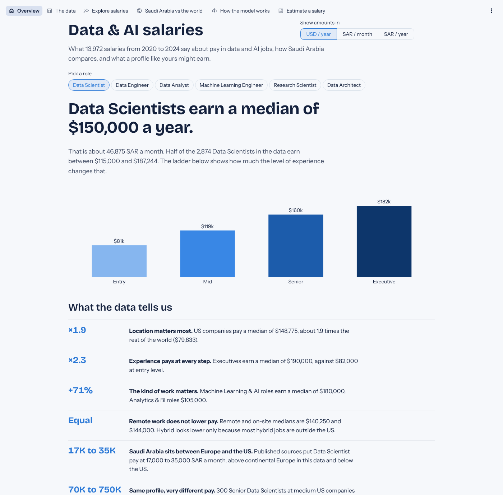
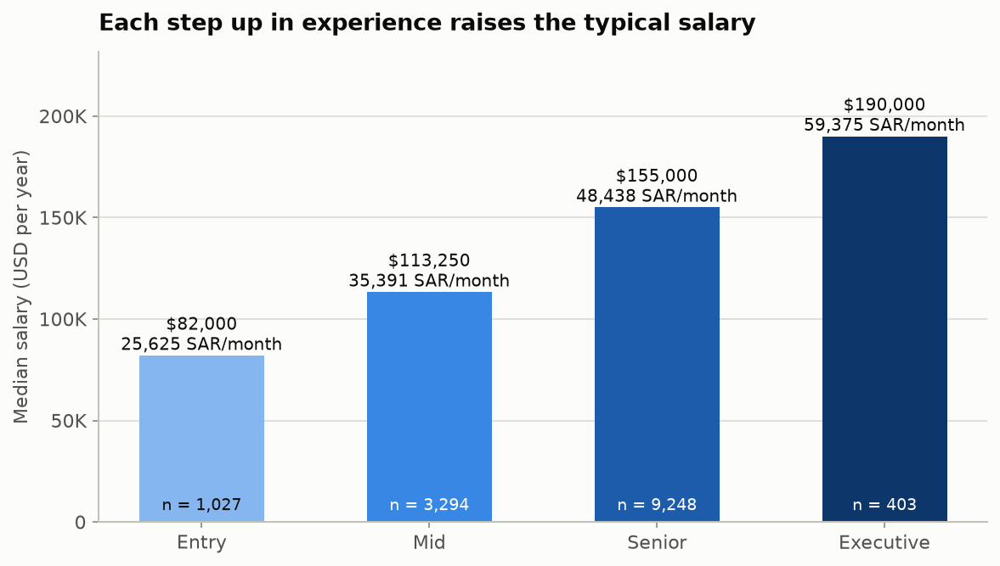
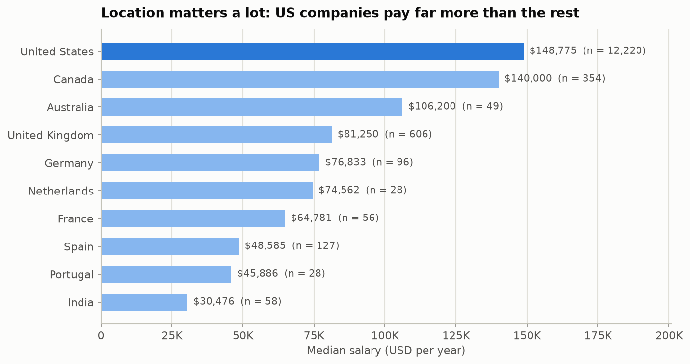
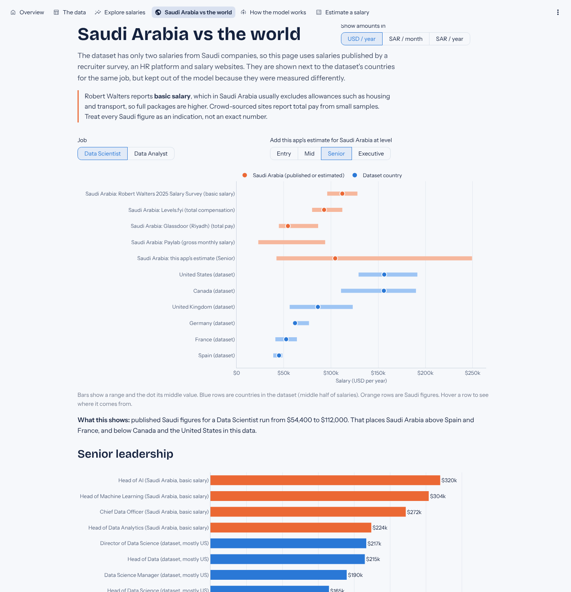
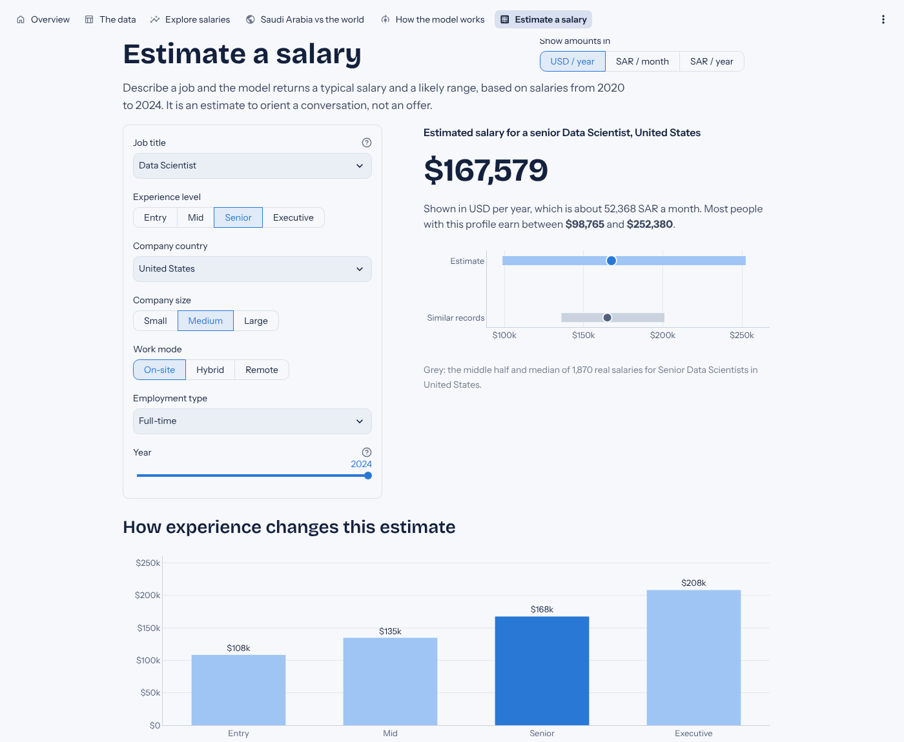

# Data & AI Salaries: analysis, salary prediction and an interactive app

What do people in data and AI jobs earn, what drives the differences, and how does Saudi Arabia compare?
This project answers those questions with 13,972 salary records from 2020 to 2024, in two separate parts:

1. **`notebooks/salary_analysis.ipynb`**: the full exploratory data analysis (EDA), cleaning, 21 charts and the machine learning model, following the Unit 3 EDA workflow step by step.
2. **`app.py`**: an interactive Streamlit app that explains the results to people without a technical background and lets anyone estimate a salary.



---

## Key findings

| | Finding |
|---|---|
| **×1.9** | **Location matters most.** US companies pay a median of $148,775, about 1.9 times the rest of the world ($79,833). |
| **×2.3** | **Experience pays at every step:** +38% from Entry to Mid, +37% from Mid to Senior, +23% from Senior to Executive. |
| **+71%** | **The kind of work matters.** Machine Learning & AI roles earn a median of $180,000, Analytics & BI roles $105,000. |
| **Equal** | **Remote work does not lower pay.** Remote ($140,250) and on-site ($144,000) are almost the same. Hybrid looks lower ($65,666) only because 80% of hybrid jobs are outside the US. |
| **17K to 35K SAR** | **Saudi Arabia sits between Europe and the US.** Published sources put Data Scientist pay at 17,000 to 35,000 SAR a month. |
| **$70K to $750K** | **Same profile, very different pay.** 300 Senior Data Scientists at medium US companies in 2023 earn anywhere in this range, which is why every estimate comes with a range. |

<p>


</p>

All amounts are US dollars per year unless stated otherwise. Saudi riyal figures use the fixed peg of 1 USD = 3.75 SAR.

---

## The data

`data/salaries.csv`: 13,972 rows and 11 columns, one row per salary.

| Column | Meaning |
|---|---|
| `work_year` | Year the salary was paid (2020 to 2024) |
| `experience_level` | EN Entry, MI Mid, SE Senior, EX Executive |
| `employment_type` | FT Full-time, PT Part-time, CT Contract, FL Freelance |
| `job_title` | Job title (146 different titles) |
| `salary`, `salary_currency` | Salary in the original currency |
| `salary_in_usd` | **Salary in US dollars: the target the model predicts** |
| `employee_residence`, `company_location` | Country of the employee and of the employer (ISO codes) |
| `remote_ratio` | 0 on-site, 50 hybrid, 100 remote |
| `company_size` | S Small, M Medium, L Large |

### Cleaning decisions

Every issue was detected, its impact measured, and the decision written down before anything changed.

| Issue | What we found | Decision |
|---|---|---|
| Missing values | None | Nothing to do |
| Hidden spaces | `strip()` changed no value; duplicate count stayed at 5,378 | `strip()` kept in the loader as a safeguard |
| Duplicate rows | 5,378 exact copies (38.5%); keeping or dropping them changes model error by less than $100, but a random split would place copies of training rows in the test set (50.2%) | Kept for charts and statistics, removed for model training |
| Invalid values and data types | None | Nothing to do |
| Outliers (IQR rule) | 253 salaries above $310,250, mostly Senior/Executive at US companies | Kept and flagged; medians and a log target reduce their pull |
| Currency | Converting to SAR changes nothing but the scale | Analysis in USD, SAR shown next to it |
| Imbalance | 87.5% US companies, 99.6% full-time, only 2 Saudi records | Kept, stated clearly, Saudi benchmarks added separately |

### New columns

`experience_label` / `experience_rank`, `company_size_label` / `company_size_rank`, `work_mode`, `job_family` (146 titles grouped into 7 families), `title_seniority`, `is_management`, `company_country`, `region`, `is_us`, `cross_border`, `salary_sar`, `monthly_sar`, `salary_band`, `is_outlier`, `log_salary`. They are built in `src/features.py`, and the notebook rebuilds them step by step to show the logic.

---

## Saudi Arabia in a global context

The dataset has only two salaries from Saudi companies, so published Saudi figures were collected in `data/saudi_benchmark.csv` (with links). They are shown next to the dataset's countries but **kept out of the model**, because they were measured differently: the Robert Walters survey reports basic salary without allowances, and the salary websites report total pay from small samples.

* **Data Scientist:** 17,000 to 35,000 SAR a month, above continental Europe in this data (Germany, France, Spain), around the UK and below the US and Canada.
* **Senior leadership:** Robert Walters reports 70,000 to 100,000 SAR a month in *basic* salary for heads of AI, machine learning and analytics, and for Chief Data Officers, at or above the dataset medians for similar, mostly US, titles.



---

## The model

| Step | What was done |
|---|---|
| Target | `salary_in_usd`, a regression problem |
| Inputs | job title (grouped), job family, seniority words in the title, company country (grouped) and region, experience, company size, work mode, employment type, year |
| Left out | `salary` and `salary_currency` (data leakage: they reveal the answer), `employee_residence` (same as company country for 99% of rows) |
| Encoding | One-hot for categories, ordinal ranks for experience and company size, scaling for the linear model |
| Split | 80/20 train/test on unique rows, plus 5-fold cross-validation |
| Models compared | Linear Regression, Decision Tree, Random Forest, Gradient Boosting, each on salary and on log of salary |
| Chosen | **Linear Regression with a small Ridge penalty, on log of salary** |
| Range | Two quantile gradient boosting models give the 10th and 90th percentiles |

All four models landed within a few hundred dollars of each other, less than the variation between cross-validation folds, so the simplest and most explainable one was chosen. **The limit is the information in the data, not the algorithm.**

| Test set (1,719 unseen salaries) | Result |
|---|---|
| Typical error (MAE) | $41,939 per year (about 13,100 SAR a month) |
| Better than always guessing the median | 23% |
| R² | 0.30 |
| Within 20% / 30% of the real salary | 42% / 60% |
| Real salary inside the predicted range | 76% |
| As a Low / Medium / High classifier | 56% accuracy (33% by chance) |

The data has no company, city, skills, education or bonus information, and people with identical inputs earn very different amounts, so a precise prediction for one person is not possible from this data.



---

## The app

| Page | What it shows |
|---|---|
| Overview | Pick a role and see its median salary and experience ladder, plus the six key findings |
| The data | Column meanings, live quality checks, the duplicates and outliers analysis, and a searchable, downloadable table |
| Explore salaries | Filters (year, experience, company size, work mode, job family, region) and seven interactive chart tabs, each with a plain-language explanation that updates to the selection |
| Saudi Arabia vs the world | Published Saudi salaries next to dataset countries, leadership pay, and every source with a link |
| How the model works | Accuracy in plain words, model comparison, what the model relies on, and why it cannot be exact |
| Estimate a salary | Enter a job, level and country to get an estimate and a likely range |

Every page has a short explanation for non-technical readers, all charts show details on hover, amounts can be switched between USD per year, SAR per month and SAR per year, and the app follows the viewer's light or dark theme.

---

## Project structure

```
salary-analysis/
├── app.py                         Streamlit app (separate from the notebook)
├── notebooks/
│   └── salary_analysis.ipynb      EDA, cleaning, charts and model
├── src/                           Small shared helpers used by both
│   ├── features.py                Loading, cleaning and new columns
│   ├── modeling.py                Model pipeline, training, saving and prediction
│   └── style.py                   One colour system for the notebook and the app
├── data/
│   ├── salaries.csv               The dataset
│   └── saudi_benchmark.csv        Published Saudi salaries with sources
├── models/                        Saved model and evaluation results (written by the notebook)
├── reports/
│   ├── figures/                   The 21 notebook charts as images
│   └── screenshots/               App screenshots for this README
├── tests/                         Automated checks for the data, the model and every app page
├── .streamlit/config.toml         App theme (colours and fonts)
├── requirements.txt               Packages for the app and the notebook
└── requirements-dev.txt           Adds Jupyter and pytest
```

The notebook and the app are separate files. They share `src/` so that a salary is cleaned, grouped and predicted exactly the same way in both, and so the saved model can be loaded by the app.

---

## Run it on your computer

Requires **Python 3.11 or newer** (tested on 3.11, 3.12 and 3.13). Check with `python --version`.

### Windows, from the VS Code terminal

Open the folder in VS Code, then **Terminal > New Terminal**, and run:

```powershell
cd C:\path\to\salary-analysis
python -m venv .venv
.venv\Scripts\python -m pip install -r requirements-dev.txt
.venv\Scripts\python -m streamlit run app.py
```

The first three lines are needed only once. After that, start the app with the last line. Keep the terminal open while you use the app, and press Ctrl+C to stop it.

> The **Run** button (▷) in VS Code runs `python app.py`, which does not start a Streamlit server. Always start the app with `streamlit run` as above.

### macOS or Linux

```bash
python3 -m venv .venv
.venv/bin/python -m pip install -r requirements-dev.txt
.venv/bin/python -m streamlit run app.py
```

* **Open the app:** the command above opens it in the browser (usually http://localhost:8501).
* **Open the notebook:** `jupyter lab notebooks/salary_analysis.ipynb`. Running it from top to bottom (about one minute) rebuilds every chart in `reports/figures/` and every file in `models/`.
* **Run the tests:** `pytest` (31 checks, about 15 seconds).

---

## Publish on GitHub and Streamlit Community Cloud

1. Create a new repository on GitHub and upload the contents of this folder (or use `git init`, `git add .`, `git commit -m "Data & AI salaries project"`, then push). The data and the model are small (under 1 MB each), so they go in the repository.
2. Sign in to [Streamlit Community Cloud](https://share.streamlit.io) with your GitHub account and choose **Create app**.
3. Pick your repository and branch, and set the main file path to `app.py`.
4. Open **Advanced settings** and check that the Python version is **3.11 or newer** (3.12 or 3.13 are fine).
5. Deploy. The first start takes a few minutes while the packages install. Add the app's link to the top of this README.

If the saved model ever fails to load (for example after a library upgrade), the app retrains the same model from the data on start-up and shows a short note on the model page.

---

## Limitations

* 87.5% of the records are from US companies and only 2 from Saudi Arabia, so results mostly describe the US market.
* The data ends in 2024 and does not reflect 2025 or 2026 pay.
* There is no information on the company, city, skills, education, exact years of experience, bonuses or equity.
* 38.5% of the rows are exact duplicates whose origin cannot be verified.
* External Saudi figures use different definitions (basic vs total pay) and different periods, so they are an indication, not an exact comparison.

---

## Sources for the Saudi benchmarks

* [Robert Walters Middle East 2025 Salary Survey](https://www.robertwalters.ae/content/dam/robert-walters-redesign/country/middle-east/files/reports---e-guides-2025/Robert%20Walters%20Middle%20East%20-%202025%20Salary%20Survey.pdf) (Saudi Arabia, Technology & Digital tables)
* [Levels.fyi: Data Scientist, Saudi Arabia](https://www.levels.fyi/t/data-scientist/locations/saudi-arabia)
* [Glassdoor: Data Scientist, Riyadh](https://www.glassdoor.com/Salaries/riyadh-saudi-arabia-data-scientist-salary-SRCH_IL.0,19_IM1652_KO20,34.htm)
* [Paylab: Data Scientist, Saudi Arabia](https://saudiarabia.paylab.com/en/salaryinfo/information-technology/data-scientist)
* [ZenHR Saudi Arabia Salary Guide](https://www.zenhr.com/en/salary-guide-ksa)
* [PayScale: Data Engineer, Saudi Arabia](https://www.payscale.com/research/SA/Job=Data_Engineer/Salary/a5bdfd56/Experienced)

Figures were collected in October 2026 and may change as the sources update.
